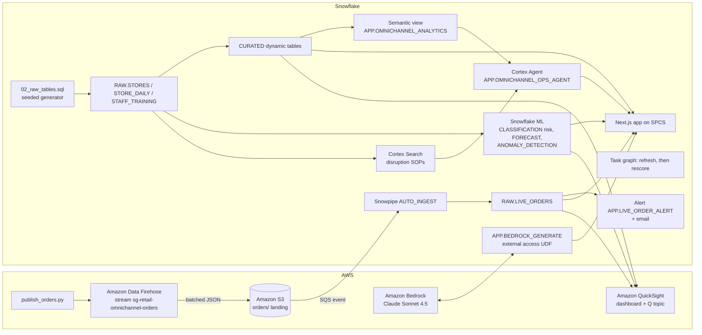

# Singapore Omnichannel Fulfilment Operations - Late Orders and Disruption Risk

End-to-end fulfilment operations for **Sagaseed Retail, a fictional Singapore omnichannel retailer, with 40 fulfilment nodes across 5 Singapore planning areas** (Jurong East, Tampines, Woodlands, Ang Mo Kio, Punggol) and 5 fulfilment channels (same-day delivery, click and collect, parcel locker pickup, ship from store, marketplace) using Snowflake, optionally with AWS: from a live late order to a 7-day fulfilment-disruption risk score, an alert email and an AI action memo for the omnichannel fulfilment team.

## Architecture

An omnichannel fulfilment pipeline built on **Snowflake** (Dynamic Tables, Snowflake ML, Cortex Search, Cortex Agent, Cortex AI_COMPLETE, SPCS) and, in the full build, **AWS** (Amazon Data Firehose, S3, Bedrock Claude, QuickSight + Amazon Q). Order fulfilment events land in `RAW.LIVE_ORDERS`. Dynamic tables curate 90 days of node-day history: orders placed, orders fulfilled on time, late orders, cancellations, fulfilment disruption hours, net sales in SGD and inventory cycle count timeliness. Snowflake ML scores 7-day fulfilment-disruption risk per node, forecasts network-wide late orders and flags order-to-ready time anomalies. A Cortex Agent answers questions with SOP citations, and an LLM drafts the fulfilment action memo.

Interactive diagrams (hover for object names): [Snowflake only](docs/architecture-snowflake.html) | [AWS + Snowflake](docs/architecture-aws.html). The app shows both on its Architecture & Data tab, the current build first. Regenerate them with `python3 docs/build_architecture.py aws` and `python3 docs/build_architecture.py snowflake`.



The Snowflake-only build drops the AWS subgraph: `APP.SIMULATE_ORDERS` writes to `RAW.LIVE_ORDERS`, and the app calls Cortex `AI_COMPLETE` instead of the Bedrock UDF.

## Snowflake Capabilities

| Capability | Implementation |
|-----------|---------------|
| Dynamic Tables | `CURATED.KPI_SUMMARY`, `PERFORMANCE_SUMMARY`, `CAUSE_SUMMARY`, `TREND_ANALYSIS` from the RAW tables |
| Snowflake ML | CLASSIFICATION 7-day fulfilment-disruption risk (`ML.DISRUPTION_RISK_SCORES`), 14-day late-order FORECAST, order-to-ready time ANOMALY_DETECTION |
| Cortex Search | 18 synthetic fulfilment disruption SOPs (one per channel and disruption cause) in `SEARCH.PLAYBOOK_SEARCH` |
| Semantic View | `APP.OMNICHANNEL_ANALYTICS` over nodes, disruption causes, daily totals and risk |
| Cortex Agent | `APP.OMNICHANNEL_OPS_AGENT`: Cortex Analyst over the semantic view plus Cortex Search for SOP citations |
| Cortex AI | `AI_COMPLETE('claude-sonnet-4-5')` for grounded answers, and for the action memo in the Snowflake-only build |
| Alerts + Tasks | `APP.LIVE_ORDER_ALERT` logs LATE orders and sends email; task graph `TASK_REFRESH_CURATED`, then `TASK_RESCORE_RISK` |
| Snowpark Container Services | Next.js app `APP.SG_RETAIL_OMNICHANNEL_APP` with 6 tabs: Executive Cockpit, Predictive, Controls, Live Orders, Ask AI, Architecture & Data |
| Snowpipe | `RAW.LIVE_ORDERS_PIPE` AUTO_INGEST from S3 (AWS build only) |

## AWS Services

Used only in the AWS + Snowflake build.

| Service | Role in Demo |
|---------|-------------|
| Amazon Data Firehose | Direct PUT stream `sg-retail-omnichannel-orders` receives simulated order fulfilment events and writes batches to S3 |
| Amazon S3 | Landing bucket (`orders/`). An event notification goes to the Snowpipe SQS queue |
| Amazon Bedrock | Claude Sonnet 4.5 writes the action memo, called from Snowflake through an external-access UDF |
| Amazon QuickSight | DIRECT_QUERY executive dashboard over Snowflake (daily late orders, disruption hours by node, fulfilment-disruption risk) |
| Amazon Q | Natural-language questions over the QuickSight topic `sg-retail-omnichannel-topic` |
| AWS IAM | Least-privilege roles for S3, Firehose and Bedrock |

## Personas

These personas are fictional.

| Persona | Role | Key Questions |
|---------|------|---------------|
| **Shanti Rajan** | VP Omnichannel Fulfilment | "What is our on-time fulfilment rate across planning areas and channels?" "Which disruption causes cost us the most late orders?" |
| **Darren Seah** | Fulfilment Network & Picker Capacity Lead | "Which nodes are at risk of a fulfilment disruption this week, and which SOP applies?" |

## Data

All data is synthetic and seeded, so every rebuild reproduces it. The retailer, its fulfilment nodes and people are fictional; the planning areas are real Singapore planning areas used as regions. Amounts are in SGD.

| Table | Rows | Description |
|-------|------|-------------|
| RAW.STORES | 40 | Fulfilment nodes: one of 5 channels (Same-day delivery, Click and collect, Parcel locker pickup, Ship from store, Marketplace) in one of 5 Singapore planning areas, with store tier, store age and inventory cycle count interval |
| RAW.STORE_DAILY | 3,600 | Daily node observations over 90 days: orders placed, orders fulfilled on time, late orders, cancellations, net sales (SGD), disruption hours and cause, cycle counts due and completed on time, average pick passes per order and average order-to-ready hours |
| RAW.STAFF_TRAINING | 40 | Required, on-file and pending staff training checks per node (picker accuracy, counter handover, locker loading, packing and labelling, marketplace listing) |
| SEARCH.PLAYBOOK_DOCS | 18 | Synthetic fulfilment disruption SOPs indexed for Cortex Search |
| RAW.LIVE_ORDERS | Grows during the demo | Live order fulfilment events from Firehose (AWS build) or `APP.SIMULATE_ORDERS` (Snowflake-only build) |
| ML.DISRUPTION_RISK_SCORES | 40 | 7-day fulfilment-disruption probability and risk band per node |

## Build Instructions

### Prerequisites
- Snowflake account with ACCOUNTADMIN access, and Cortex AI enabled (AI_COMPLETE, Search, Agent).
- An X-Small warehouse with auto-suspend at or below 120 s, and an existing SPCS compute pool.
- Python 3.11+, `snowflake-connector-python`, Node.js 22+, Docker and the `snow` CLI.
- App image: run `snow spcs image-registry login`, then build and push `sg-retail-omnichannel-app:v1` to the database's `APP.IMAGES` repository (see the header of `snowflake/07_deploy_app.sql`).
- AWS build only: `boto3`, AWS credentials for the target account (us-west-2) with Bedrock access, and QuickSight Enterprise.

### SPCS App
```
<DATABASE>.APP.SG_RETAIL_OMNICHANNEL_APP
```

### Tests
```bash
python -m pytest aws snowflake quicksight
```

For a local run, put `SNOWFLAKE_ACCOUNT`, `SNOWFLAKE_USER`, `SNOWFLAKE_DATABASE`, `SNOWFLAKE_WAREHOUSE`, `SNOWFLAKE_AUTHENTICATOR=PROGRAMMATIC_ACCESS_TOKEN`, `SNOWFLAKE_TOKEN` and `DEMO_PLATFORM` in the environment, then run `npm --prefix app run build && npm --prefix app start`.

## Build Modes

Both modes share the same core. They differ in three places, and the app's `DEMO_PLATFORM` setting (in its SPCS spec) switches the memo provider and the Live Orders tab.

| Layer | Snowflake Only | Full AWS + Snowflake |
|---|---|---|
| Live orders | `CALL APP.SIMULATE_ORDERS(n)` inserts simulated order fulfilment events into `RAW.LIVE_ORDERS`. This simulates an order feed; it is not Snowpipe Streaming | `aws/publish_orders.py` to Amazon Data Firehose, then S3, SQS and Snowpipe AUTO_INGEST |
| Action memo | Cortex `AI_COMPLETE('claude-sonnet-4-5')` | Amazon Bedrock Claude Sonnet 4.5 through `APP.BEDROCK_GENERATE` |
| BI and natural-language questions | The SPCS app is the dashboard; questions go to the Cortex Agent | Also a QuickSight dashboard and an Amazon Q topic |
| App setting | `DEMO_PLATFORM: snowflake` | `DEMO_PLATFORM: aws` |

### Snowflake Only

```bash
# 1. Core data and dynamic tables (guarded: new isolated database only)
python snowflake/run_core.py --database SINGAPORE_RETAIL_OMNICHANNEL_SNOWFLAKE --warehouse <XS_WAREHOUSE> --connection <CONNECTION> --apply
# 2. Native order feed, ML, search, semantic view, agent, alert and task graph
python snowflake/run_intelligence.py --database SINGAPORE_RETAIL_OMNICHANNEL_SNOWFLAKE --platform snowflake --warehouse <XS_WAREHOUSE> --connection <CONNECTION> --alert-email you@example.com
# 3. App on SPCS with DEMO_PLATFORM=snowflake (push the image first)
python snowflake/run_intelligence.py --database SINGAPORE_RETAIL_OMNICHANNEL_SNOWFLAKE --platform snowflake --warehouse <XS_WAREHOUSE> --connection <CONNECTION> --alert-email you@example.com --files 07_deploy_app.sql --compute-pool <COMPUTE_POOL>
```

During the demo:
- Run `CALL APP.SIMULATE_ORDERS(20)` to add live orders. For a continuous feed, run `ALTER TASK APP.TASK_SIMULATE_ORDERS RESUME`, and `SUSPEND` it afterwards.
- Run `EXECUTE ALERT APP.LIVE_ORDER_ALERT` to raise the alert email.
- Run `EXECUTE TASK APP.TASK_REFRESH_CURATED` to refresh the curated tables and rescore risk.

Afterwards, drop the database or run `ALTER SERVICE APP.SG_RETAIL_OMNICHANNEL_APP SUSPEND`.

### Full AWS + Snowflake

```bash
# 1. Core data and dynamic tables (guarded: new isolated database only)
python snowflake/run_core.py --database SINGAPORE_RETAIL_OMNICHANNEL_AWS --warehouse <XS_WAREHOUSE> --connection <CONNECTION> --apply
# 2. AWS ingestion and Bedrock (dry run first, then --apply)
python aws/setup_aws.py --database SINGAPORE_RETAIL_OMNICHANNEL_AWS --account <AWS_ACCOUNT_ID> --connection <CONNECTION> --apply
# 3. ML, search, semantic view, agent, alert and task graph
python snowflake/run_intelligence.py --database SINGAPORE_RETAIL_OMNICHANNEL_AWS --platform aws --warehouse <XS_WAREHOUSE> --connection <CONNECTION> --alert-email you@example.com
# 4. App on SPCS with DEMO_PLATFORM=aws (push the image first)
python snowflake/run_intelligence.py --database SINGAPORE_RETAIL_OMNICHANNEL_AWS --platform aws --warehouse <XS_WAREHOUSE> --connection <CONNECTION> --alert-email you@example.com --files 07_deploy_app.sql --compute-pool <COMPUTE_POOL>
# 5. QuickSight dashboard and Q topic (needs an existing Snowflake data source)
python quicksight/build_dashboards.py --database SINGAPORE_RETAIL_OMNICHANNEL_AWS --account <AWS_ACCOUNT_ID> --principal-arn <QUICKSIGHT_USER_ARN> --data-source-arn <DATA_SOURCE_ARN> --prefix sg-retail-omnichannel --apply --update --with-topic
```

QuickSight objects must be shared with the QuickSight user who signs in (`--principal-arn`); otherwise the console shows nothing.

During the demo:
- Run `python aws/publish_orders.py --count 20` to send live order fulfilment events. Firehose buffers for up to 60 seconds before writing to S3.
- Run `EXECUTE ALERT APP.LIVE_ORDER_ALERT` to raise the alert email.
- Run `EXECUTE TASK APP.TASK_REFRESH_CURATED` to refresh the curated tables and rescore risk.

Afterwards, `python aws/teardown_aws.py --database SINGAPORE_RETAIL_OMNICHANNEL_AWS --account <AWS_ACCOUNT_ID> --connection <CONNECTION> --apply` removes the AWS resources and the account-level Bedrock external-access and S3 storage integrations. It leaves the email integration `SG_RETAIL_OMNICHANNEL_EMAIL_INT`, which the Snowflake-only build also uses.

## Business Impact

Official statistics and a Snowflake customer outcome:
- **Online sales are 15.7% of Singapore retail trade sales**: SingStat's "Online Retail Sales Proportion (Out Of The Respective Industry's Total Sales), Monthly" table gives 15.7 (percentage) for Retail Trade in 2026 Aug, up from 4.4 in 2018 Jan -- [SingStat Table Builder M602191](https://tablebuilder.singstat.gov.sg/table/TS/M602191)
- **Click and collect counts as online retail in Singapore's statistics**: the same table defines online retail sales as orders received remotely and agreed via online means, "regardless of how or where the goods are delivered or collected" -- [SingStat Table Builder M602191](https://tablebuilder.singstat.gov.sg/table/TS/M602191)
- **Kraft Heinz** (Snowflake customer, consumer goods) shares data with retail partners through Snowflake: "Relevant data includes the joint supply chain, inventory data, sales, and distribution channels on both sides", and "retailers can simply update tables and then CPG manufacturers like Kraft Heinz can see the same data without delay" -- [Snowflake blog: Kraft Heinz Fosters Deeper Collaboration with Retail Partners](https://www.snowflake.com/en/blog/kraft-heinz-fosters-collaboration-retail-partners/)

## Key Demo Numbers

These figures are synthetic and come from the seeded demo data. Forecast and anomaly figures can shift slightly with the build day.

- **40 fulfilment nodes** across 5 Singapore planning areas and 5 channels, 3,600 node-days over 90 days; **2,007,954 orders placed**, **1,879,058 fulfilled on time** and net sales of SGD 129.5 M
- **On-time fulfilment rate 93.6%**: **86,020 late orders** missed their promised time, and the order cancellation rate is 2.1% (42,876 orders). Jurong East has the lowest on-time rate (93.2%); Woodlands and Ang Mo Kio the highest (93.8%)
- **303 fulfilment disruption hours** on **106 disruption node-days**; the two mega-sale order surges (Tampines and Jurong East) cause the most (80 hours on 16 node-days), and packing station outages lead the node-driven causes (41 hours on 16 node-days)
- **Fulfilment-disruption model** out-of-time holdout (600 node-days): precision 0.22, recall 0.15 at a 0.5 threshold, against a 0.125 base rate. Precision is above the base rate but recall is low, so the scores are for triage. Six nodes are high risk; the top node is STR-0030 (Jurong East, ship from store), at 98.2%
- **14-day late-order forecast** with prediction intervals; **29 of 640** node-days flagged as order-to-ready time anomalies
- **Cycle count on-time rate 78.6%**, staff training coverage 44.3%, with 27 trainings pending
- **18 SOPs** indexed for Cortex Search and cited by ID in agent answers

## License

Apache 2.0 — See [LICENSE](LICENSE) for details.

This is a personal demo project and is not an official Snowflake offering. It comes with no support or warranty. Industry metrics cited are from publicly available third-party research and Snowflake customer stories; they represent reported outcomes and are not guarantees of results.
